

<h2>Who we are</h2>

AMRI is a network of aquatic microbial ecologists in Sweden, bringing together researchers from universities across the country. The network is coordinated by the AMRI Steering Board, with active support and contributions from AMRI members.

<h3 id="amri-steering-board-2024-present">AMRI Steering Board, 2024–present</h3>

  

    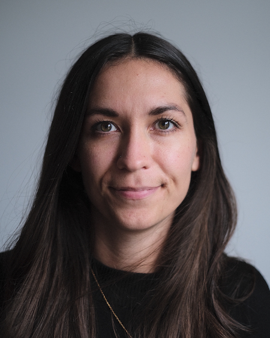
    

      <a href="https://www.su.se/english/profiles/embe6171-1.782770" target="_blank" rel="noopener noreferrer">Emma Bell</a> 
      <small>Stockholm University</small>
    

  

  

    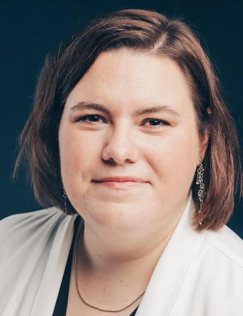
    

      <a href="https://www.gu.se/om-universitetet/hitta-person/carinabunse" target="_blank" rel="noopener noreferrer">Carina Bunse</a> 
      <small>University of Gothenburg</small>
    

  

  

    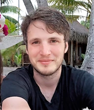
    

      <a href="https://www.umu.se/en/staff/eric-capo/" target="_blank" rel="noopener noreferrer">Eric Capo</a> 
      <small>Umeå University</small>
    

  

  

    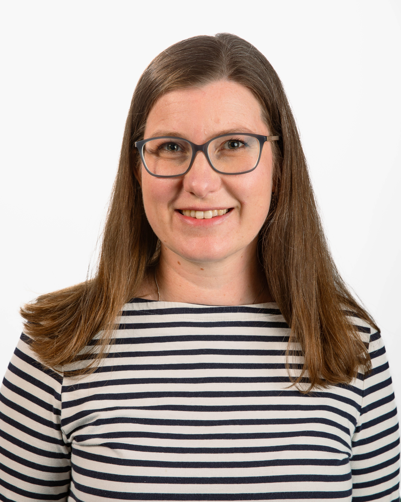
    

      <a href="https://lnu.se/en/staff/hanna.farnelid/" target="_blank" rel="noopener noreferrer">Hanna Farnelid</a> 
      <small>Linnaeus University</small>
    

  

  

    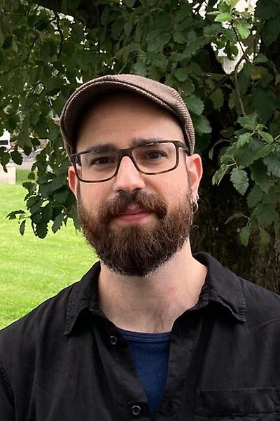
    

      <a href="https://www.uu.se/en/contact-and-organisation/staff?query=N16-1877" target="_blank" rel="noopener noreferrer">Javier Florenza García</a> 
      <small>Uppsala University</small>
    

  

  

    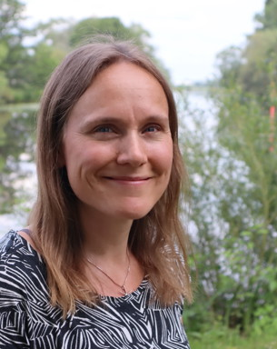
    

      <a href="https://www.slu.se/en/profilepages/o2/malin-olofsson/" target="_blank" rel="noopener noreferrer">Malin Olofsson</a> 
      <small>SLU Uppsala</small>
    

  

  

    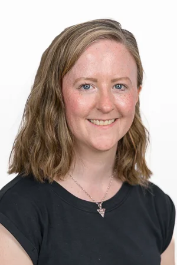
    

      <a href="https://www.uu.se/en/contact-and-organisation/staff?query=N16-809" target="_blank" rel="noopener noreferrer">Courtney Stairs</a> 
      <small>Uppsala University</small>
    

  

<h2>Background</h2>

From 2019–2023, the AMRI network was led by four principal investigators and funded by [SciLifeLab](https://www.scilifelab.se). Together, they brought researchers in aquatic microbial ecology together around four themes:

1. Microorganisms as ecosystem engineers.
2. Microbial interactions and evolution.
3. Microbial biogeography across and within aquatic biomes.
4. Bioinformatics of aquatic microbes.

In 2024, a new generation of aquatic microbial ecologists took over the AMRI Steering Board, building on this original initiative and continuing to strengthen collaborations between researchers across Sweden.

<h3 id="amri-steering-board-2019-2023">AMRI Steering Board, 2019–2023</h3>

  

    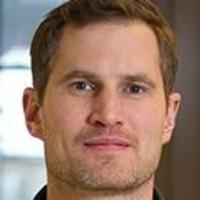
    

      <a href="https://www.kth.se/profile/andand" target="_blank" rel="noopener noreferrer">Anders Andersson</a> 
      <small>KTH Royal Institute of Technology</small>
    

  

  

    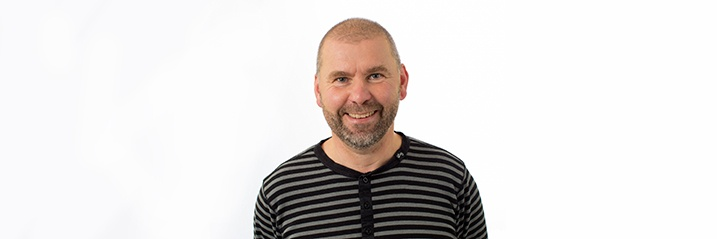
    

      <a href="https://www.slu.se/en/profilepages/b/stefan-bertilsson/" target="_blank" rel="noopener noreferrer">Stefan Bertilsson</a> 
      <small>SLU Uppsala</small>
    

  

  

    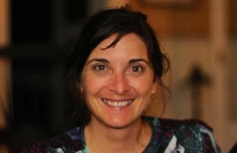
    

      <a href="https://www.su.se/english/profiles/rfost-1.194443" target="_blank" rel="noopener noreferrer">Rachel Foster</a> 
      <small>Stockholm University</small>
    

  

  

    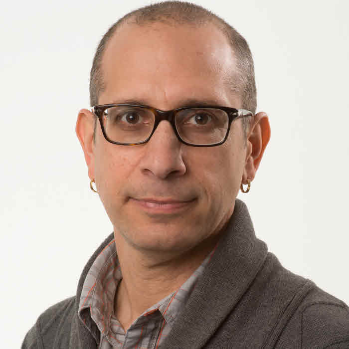
    

      <a href="https://lnu.se/en/staff/jarone.pinhassi/" target="_blank" rel="noopener noreferrer">Jarone Pinhassi</a> 
      <small>Linnaeus University</small>
    

  

